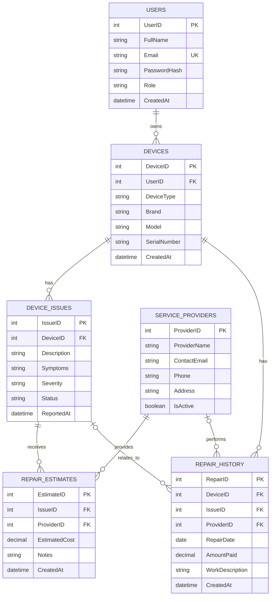

# RepairIQ – ER Diagram

Paste this Mermaid code into Mermaid Live Editor or a Markdown viewer that supports Mermaid.

## Relationship explanation
- One user can register many devices (1:M).
- One device can have many reported issues (1:M).
- One issue can receive estimates from multiple service providers (1:M).
- One service provider can submit many estimates (1:M).
- One device can have multiple repair-history entries (1:M).
- A repair-history entry may optionally refer to an issue and a service provider.
