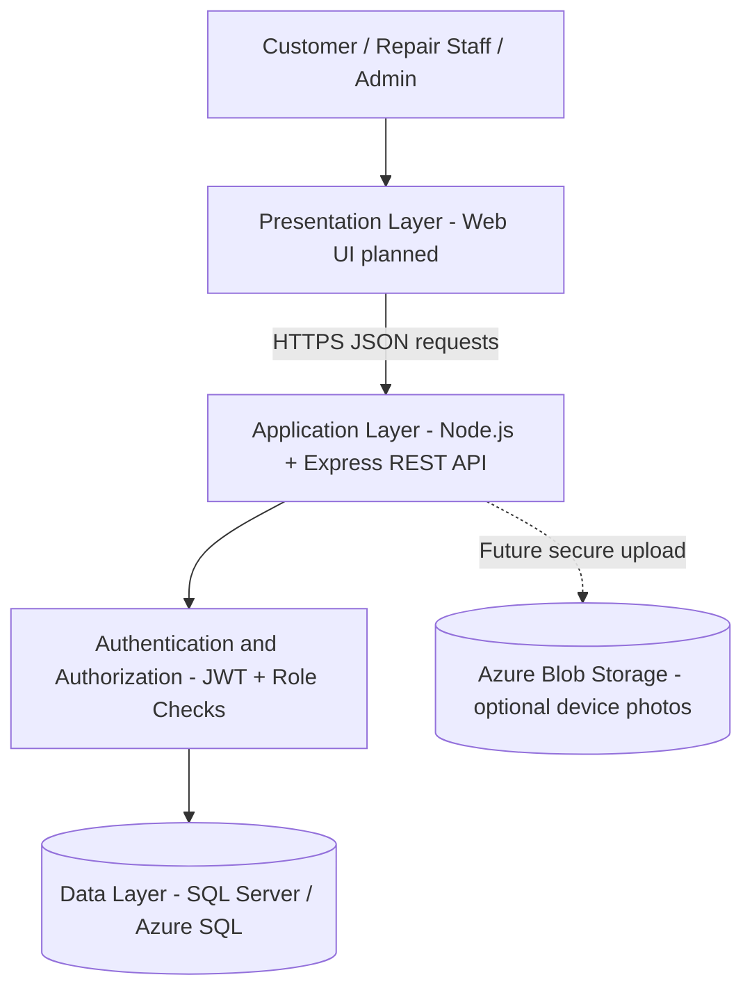

# RepairIQ – System Architecture

## Three-tier architecture

## Layer responsibilities

| Layer | Technology | Responsibility |
|---|---|---|
| Presentation | Web frontend (planned) | Forms, dashboards and results |
| Application | Node.js + Express | Business logic, validation and REST APIs |
| Security | JWT, bcrypt, RBAC | Login, password protection and access control |
| Data | SQL Server / Azure SQL | Users, devices, issues, estimates and repair records |
| Object storage | Azure Blob Storage (future) | Optional photos and documents |

## Request flow
1. A user sends an HTTPS request from the frontend.
2. Express validates the request body and authentication token.
3. Authorization checks the user's role and record ownership.
4. The API runs parameterized SQL against the database.
5. The API returns JSON without exposing internal database errors.

The included deliverable implements the REST API and SQL schema. Frontend and Blob Storage are planned components, not completed integrations.
